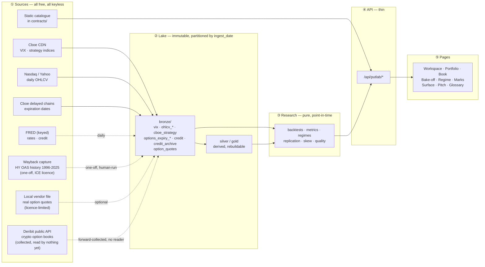
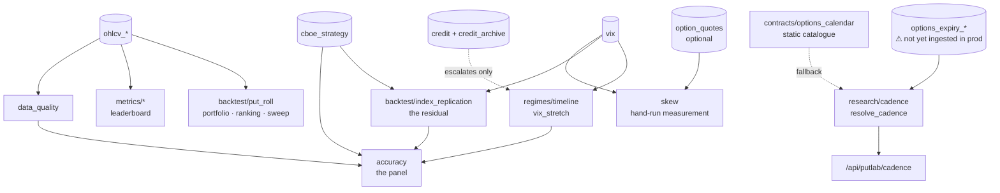

# Data flow — where every number on the screen comes from

**What this file is.** A lineage map: for each page of the app, which data
sources feed it, how the data gets from a vendor's file to a pixel, and what
breaks when a source dies.

**What it is not.** `ARCHITECTURE.md` owns *structure* — the layer rule, the
deployment topology, where new code goes — and is not repeated here. Read that
one to know where code lives; read this one to know where a **number** came
from. `docs/DATA_CONTRACTS.md` owns each dataset's schema;
`docs/DATA_FINDINGS.md` owns which sources currently work.

Two audiences, and they want different things, so the file is layered: §1 is
the one-screen map, §2–§3 are the per-page and per-source registers a person
debugging a wrong number needs, and §4 is the impact analysis to run *before*
changing a source.

---

## 1. The one-screen map

Free vendor → immutable bronze → a pure research function → a thin route → a
component. Five hops, no exceptions, and the arrows only ever point right.

**The one rule that makes the map trustworthy.** Every read into the lake goes
through `LakeStore.read_bronze_as_of(dataset, as_of)`, which returns the latest
snapshot ingested **on or before** `as_of` and never merges partitions
(`docs/adr/0009`, `docs/adr/0013`). So any number on any page can be traced to
exactly one bronze partition, and re-running with the same `as_of` reproduces
it. The corollary is the trap: a **new partition shadows the old one**, so
re-ingesting a symbol from a different vendor silently changes every downstream
number (`docs/DISCOVERIES.md` #2).

---

## 2. What feeds each page

The app is one workspace with eight tabs. Each row lists what the tab answers,
the endpoints it calls, and the bronze datasets those endpoints ultimately read.

Screen and Backtest used to be separate tabs, bridged by a fragility ranking
pinned above both — you picked a name on one and read its result on the other.
They are one **Workspace** now, with the ranking as a strip at its top, and the
Screen tab's deeper "is the screen any good?" question moved to its own
**Bake-off** tab (`docs/adr/0017`). Recommendations folded into that strip on
2026-10-11 as its best-return order (`docs/adr/0028` amendment).

| Page / tab | The question it answers | Endpoints | Datasets read |
|---|---|---|---|
| **Workspace** | Which name, and what would that hedge have done? | `/api/putlab/leaderboard` (the ranking strip, one read for both its orders: by fragility, and by best return -- the old Recommendations table, with the roll-schedule export -- bounded to the priced band per `docs/adr/0018`), `/api/putlab/signal-test` (the strip's verdict line: the out-of-sample signal test at fixed settings Δ0.10 · 4w · 4y · top 5, `docs/adr/0033`; warmed daily after the bake-off where `TAIL_LAB_WARM_RANKING` is on), `/api/putlab/signal-test/{symbol}` and `/api/putlab/coverage/{symbol}` (the per-name *How the signals treated this name* and *Data coverage* sections; coverage reads OHLCV and dividend dates only, and the quote row reads `/api/putlab/marks` lazily, on expand, for collected names only), `/api/putlab/metric-screen` (formerly the strip line; now read only by the Bake-off's collapsed in-sample section, on its Run button, at the rail's settings; the daily warm still pre-computes the default rail's 5% · 4w · 4y · top 5 by distance; pre-computed daily where `TAIL_LAB_WARM_RANKING` is on, as `fly.toml` sets it -- it is off by default, so a local first load of the day computes it cold, one backtest per screened name), `/backtest`, `/sweep`, `/regime-verdict`, **`/accuracy`**, `/strike-preview` ("How the strike is chosen": today's delta strike at realised vol beside the market's on the chain's IV) | `ohlcv_*` (whole screening universe + `ohlcv_spy` as benchmark), `vix`, `cboe_strategy`, `tiingo_eod` (q), `option_chain_snapshot` (the preview's market row only) |
| **Portfolio** | What does a blend of legs do? | `/api/putlab/portfolio`, `/api/putlab/leaderboard` | `ohlcv_*` |
| **Book** | How much of the book should carry the hedge? (Rodman's Paradox: does any mix out-grow both 0% and 100% hedged?) | `/api/putlab/hedge-overlay` (lump sum: one read per as-of date; 404 with no Cboe snapshot) and `/api/putlab/book-plan` (monthly contributions, `docs/adr/0027` §3: IRR per arm, rolling starts, comparators) and `/api/putlab/book-plan/model` (the opt-in model source: $X/month on S&P 500 puts priced by Black-Scholes at the VIX plus the measured skew gap) | `cboe_strategy` (`SPX` + `PPUT`, `PPUT3M`, `VXTH`, and the other Cboe indices as comparators); `tiingo_eod` (SPY only: the S&P 500 leg is SPY's measured total return, fee-adjusted — `research/backtest/index_leg.py`, one builder for the lump sum and the plan; SPX price fills at most 14 trailing days); `rates` (`DGS3MO`: the T-bill comparator, and the conservative leg's cash drag — point-in-time from 2005-06-28, latest vintage before it, `docs/adr/0027` amendment); `vix` (model source only). "How much to hold" (`OverlayWindow.sizing`, `research/backtest/hedge_sizing.py`) is computed from the same blend |
| **Bake-off** | Which screen actually picks winners? | `/api/putlab/signal-test` (the headline: the out-of-sample walk-forward at the strip's fixed settings, warmed daily; the Run button asks it at the rail's settings, `docs/adr/0033`; each result also carries `beyond_vol`, the Fama–MacBeth test of fragility beyond trailing vol on the same periods (no extra read), and `beyond_vol_mode`: `confirmatory` only at 0.10Δ · 4w · 4y · top 5 on the pre-registered data date 2026-10-31, `monitoring` for that setting on any later date, `exploratory` elsewhere -- only a confirmatory result shows a p-value and a status, the others show γ̄ and its CI; the test is skipped above 120 periods, then `beyond_vol` is null and `beyond_vol_unavailable_reason` says why, `docs/adr/0035`), `/api/putlab/metric-screen` (the collapsed in-sample section, fetched only when opened — one backtest per screened name, up to 70; a run on parameters already computed that day is served from the server's in-process memo (a deploy or restart empties it), and the Workspace line's fixed parameters are pre-computed daily when `TAIL_LAB_WARM_RANKING` is on) | `ohlcv_*` (+ `ohlcv_spy` as benchmark), `vix`, `tiingo_eod` (q) |
| **Surface** | How fat a tail is the option market pricing, against the name's own history? | `/api/putlab/surface` (one chain session; the anchor is the rail's strike, the expiry its tenor) | `option_chain_snapshot`, `ohlcv_<asset>`, `tiingo_eod` (q) |
| **Regime** | What market are we in? | `/api/putlab/regimes`, `/api/vix/stretch`, `/accuracy` (the per-regime residual) | `vix`, `cboe_strategy`, `credit` + `credit_archive` (widening, §3.2) |
| **Marks** | For this name, how deep out of the money, at which tenor and in which years and regimes does the lake hold a usable put quote? | `/api/putlab/marks` (aggregated inside DuckDB via `LakeStore.bronze_relation_as_of`; memoised per name and day for 6 h — a cold SPY read is ~13 s) | `optionsdx_quotes_<sym>` (spy, qqq, nvda, tsla; stored only to 40% out and 120 days), `option_chain_snapshot` (every partition up to as-of, to 60% out), `ohlcv_<sym>` (the price-series span), `vix` + `credit` + `credit_archive` (the regime each session is filed under) |
| **Pitch** | Is there a genuine edge in buying puts, on real quotes? (`docs/adr/0021` 2026-10-27 amendment) | none — a committed study: `frontend/src/content/pitch_evidence.json`, written offline by `make pitch-evidence` (`scripts/pitch_evidence.py`, which records the snapshot ids and its own commit), plus a hand-dated `LIVE` block in `content/pitch.ts` read from `/regime-verdict`, `/backtest`, `/roll-schedule/marked` and `/hedge-overlay` | `optionsdx_quotes_spy`, `optionsdx_quotes_qqq`, `option_quotes` (2008-09), `vix`, `rates`, `cboe_strategy` — read at build time, not by the server. Stale until someone reruns the script and commits the JSON; the `LIVE` readings are stale from the day after their date |
| **Glossary** | — (renders `content/concepts.ts`, no network) | none | none |
| **Roll schedule** (export, not a tab) | What would I actually place? | `/api/putlab/roll-schedule` (the ranking's read at the rail's screen, reused from cache; its legs are each name's best cell, so the screen's strike is a label only) | `ohlcv_*`, `vix`, `tiingo_eod` (q, per leg) |
| **Control rail** (the tabs that read it: `rail.ts`, `docs/adr/0028`) | What position am I asking about, and where did the data come from? | `/api/putlab/universe`, `/cadence`, `/data-quality` | `ohlcv_<asset>`, the options calendar |

**A strike rule travels with the request on four routes only.** `/backtest`,
`/regime-verdict`, `/metric-screen` and `/signal-test` take `strike_rule=delta&target_delta=…`
(`docs/adr/0029`), and `/strike-preview` takes a `target_delta` of its own;
every other route — the ranking, sweep, Surface, accuracy,
roll schedule and hypothesis memory — reads `moneyness_pct` alone. So on the
Workspace in delta mode the headline, tape, ledger and regime verdict are by
delta while the ranking strip, sweep grid and accuracy panel beside them are
by distance (the strip's verdict line is the signal test at a fixed 0.10Δ,
whatever the rail says, `docs/adr/0033`), and the page says so beside each. A delta
backtest's strikes are solved from realised vol; the market's delta strike
appears only in `/strike-preview`, from one Cboe chain session.

The ranking strip has no per-name sparklines: `RankedAsset` carries scalars
only, and a series per name would bloat the universe-wide response.

**The accuracy panel is the densest node in the graph.** It renders under every
backtest result and, alone in the app, reads *four* datasets at once — the
replication residual (`cboe_strategy` + `vix`), the benchmark comparison
(`cboe_strategy`), the regime mix (`vix`), and the input scan
(`ohlcv_<asset>`). It is also the only endpoint that **must not 404**: each
block degrades independently, because a blank accuracy panel reads as "no
concerns" (README, *Accuracy is surfaced, not filed*).

Two things on this map are **not** in the lake at all:

- **The screening universe** (`/api/putlab/universe`) comes from a static
  catalogue in `contracts/options_calendar.py`. No freshness, no failure mode.
- **The options-cadence labels** (`/api/putlab/cadence`) now prefer the lake
  (`research/cadence.py` reads the `options_expiry_*` bronze partition
  as-of-date and classifies it) but fall back to that same static catalogue
  whenever a symbol has no snapshot yet — see §3.1, no longer a dangling
  branch but still waiting on its first production ingest.
- **Feedback and hypothesis memory** are JSON blobs under `ops/` via
  `BlobStore`, not Delta tables — different lifecycle, never point-in-time
  read (`docs/adr/0014`, `docs/adr/0015`).

---

## 3. Source register

Every source, what it produces, and how it is fetched. "Keyless" means no
account, no API key, no money — the constitution's free-data-first rule.

| Source | Produces | Cadence | Keyless | Fallback | Fetched by |
|---|---|---|---|---|---|
| **Cboe CDN** — `VIX_History.csv` | `vix` (1990→) | daily | ✅ | Yahoo | `make ingest-vix` |
| **Cboe CDN** — `{TICKER}_History.csv` | `cboe_strategy` (11 indices, 1975→) | daily | ✅ | none | `make ingest-cboe-strategy` |
| **Nasdaq** historical | `ohlcv_<symbol>` | daily | ✅ | Yahoo | `make ingest-ohlcv SYMBOL=…` |
| **Cboe** delayed quote chain | `options_expiry_<symbol>` | daily | ✅ | Yahoo (cookie+crumb) | `make ingest-options-expiry SYMBOL=…` |
| **Cboe** delayed quote chain (daily sweep) | `option_chain_snapshot`, `option_chain_call_snapshot` (ADR 0020/0031) | daily | ✅ | none — unrecoverable | `daily-chain-snapshot.yml` / `make ingest-option-chain` |
| **Deribit** public API — `get_book_summary_by_currency` + `get_instruments` | `deribit_options_btc`, `deribit_options_eth`, `deribit_options_usdc` (ADR 0032, `docs/DATA_CONTRACTS.md` #16) | daily | ✅ | none — past sessions are sold (Tardis.dev), not served | `daily-deribit-snapshot.yml` / `make ingest-deribit` |
| **FRED** — sliding 3-year window | `credit` (HY + IG OAS) | daily | 🔑 `FRED_API_KEY` | `credit_archive` for 1996 → 2025-11-03 | `make ingest-credit` |
| **Wayback** — pinned capture of FRED's full HY OAS history (ICE data, internal use) | `credit_archive` (ADR 0034) | one-off | ✅ keyless; human-run once after merge (licence confirmed by Dio 2026-10-31 (internal use only; values never served publicly)) | none newer exists | `make ingest-credit-archive` |
| **Tiingo** daily prices | `tiingo_eod` — as-traded close, dividends, splits, whole universe, 1993→ | weekly (Sat) | 🔑 `TIINGO_API_KEY` | none | `make ingest-tiingo-eod` (`scripts/weekly_tiingo_refresh.sh`) |
| **Local vendor file** — lambdaclass `data-v1` | `option_quotes` (42,131 real SPY quotes, 2008→2025) | one-shot | ✅ (manual download) | none | `make ingest-option-quotes` |
| **Static catalogue** | screening universe, options-cadence fallback | n/a | ✅ | n/a | none — it is code |

### 3.1 `options_expiry` — wired 2026-08-30, still waiting on its first ingest

This map originally surfaced a gap: `ingestion/options_expiry.py` and
`transforms/options_expiry.py` existed and were tested, but nothing ran the
adapter and `/api/putlab/cadence` never read the result — a pipeline that
looks wired on a dependency graph and is inert in production. That is fixed
on the code side: `research/cadence.py` reads the `options_expiry_<symbol>`
bronze partition as-of-date, classifies it with
`transforms/options_expiry.classify_cadence`, and `/api/putlab/cadence` calls
it; `make ingest-options-expiry SYMBOL=…` now exists to populate the
partition.

**Still true today:** no `options_expiry_*` partition exists in production
bronze — running the ingest target is a human action (`AGENT_MISSION.md`'s
"data changes" rule), not one the daily agent takes. Until Dio runs it for a
symbol, `resolve_cadence` falls back to the static catalogue exactly as
`/api/putlab/cadence` always has, so production behavior is unchanged for now.
The moment a symbol has a snapshot, its cadence label switches from
`"Weeklies/Monthlies (assumed)"` to `"Weeklies/Monthlies (live)"` with no
further code change.

### 3.2 `credit` + `credit_archive` — the union read, live since 2026-09-22

Same shape as §3.1, one dataset later. `research/regimes/timeline.py:load_credit_oas`
assembles the HY OAS history (`docs/adr/0034`):

- **Union read.** FRED serves a sliding 3-year window, and each daily `credit`
  partition holds one. The loader reads EVERY partition `<= as_of` (not the
  newest alone), the newest partition winning per observation.
- **Archive split.** `credit_archive`, a one-off pinned Wayback capture, is
  authoritative for `obs_date <= archive_end` (its own maximum, 2025-11-03);
  live serves only after it.
- **Classification.** `contracts/regime.classify_credit_series` (same
  hysteresis engine as VIX, different thresholds), then
  `compute_regime_timeline` takes the more severe of the VIX and credit labels
  (`contracts/regime.combine_regime_labels`) — credit stress can only escalate
  the regime shown, never talk a crisis-VIX day down.
- **Alignment.** A print counts from its publication date for 10 business
  days; after that VIX decides and a warning is logged.

Live `credit` partitions have been written every weekday since 2026-09-22
(`tail-lab-refresh.timer` → `make ingest-credit`). The archive is not ingested
until Dio runs `make ingest-credit-archive` once after merge (licence confirmed by Dio 2026-10-31 (internal use only; values never served publicly)); until
then the history starts at 2023-09, as the union of the live partitions.

**Sources do not depend on each other.** Every arrow in §1 runs source →
lake; there is no source that must be fetched before another. What *is*
coupled is downstream: several research functions need **two or three
datasets to line up on the same dates**, and that is where breakage actually
appears.

**Read the fan-in, not the fan-out.** `ohlcv_*` feeds the most consumers, but
`accuracy` is the node that fails in the most ways — it depends on three
datasets and two research modules, which is exactly why it was built to
degrade block by block instead of raising.

---

## 4. Impact analysis — what breaks if a source dies

Run this table *before* changing or re-ingesting a source, not after. Every
free source here has already degraded at least once: Yahoo went from "works" to
"429s everywhere" in two days and nothing noticed until a human looked
(`docs/DATA_FINDINGS.md`).

| If this dies | Breaks immediately | Still works | Detected by |
|---|---|---|---|
| **Cboe VIX** | Regime tab, VIX stretch tile, the residual, the regime mix in the accuracy panel | every backtest, the ranking, the screen | nothing yet — canary is queued |
| **Cboe strategy indices** | the residual, the benchmark table in the accuracy panel | everything else; the panel drops two blocks and says so | nothing yet |
| **OHLCV (Nasdaq + Yahoo both)** | **everything** — no price path, no backtest, no ranking | the Regime tab | the backtest 404s loudly |
| **Cboe chains + Yahoo** | nothing yet — no production partition exists to lose (§3.1) | everything, including the cadence panel (fallback to the static catalogue) | n/a |
| **FRED credit** | credit stale more than 10 business days: those dates fall back to VIX-only labels. A seam gap, or no live HY after the archive's end: a 500 (`CreditHistoryError`) on the regime-bearing routes | everything else; the regime stays VIX-labelled | the `event=regime.credit_stale` warning; an HY run with no valid rows is refused (non-zero exit), which fires the refresh alert |
| **Tiingo `tiingo_eod`** | nothing breaks: every price keeps the last yields with their age — a measured yield (including a scaled `short_history` one) is labelled **carried**, then `stale` after 21 days; a real zero (`non_payer`, `suspended`) keeps its own label however old; a symbol never fetched (or withheld for a bad row) prices at q = 0 labelled `unknown`. Before the first ingest every roll is `unknown` — the old q = 0 prices | everything; the Surface falls back to its old assumed 1.9% yield, labelled; the Book falls back to SPX plus an assumed 1.9% yield, labelled, and **withholds every recommended size** ("sizing needs measured dividends"). A feed more than 14 days behind the Cboe calendar is not extended, so Book windows show as clipped | `tail-lab-alert@tiingo` on a failed weekly run; every result's `q_source` / `dividend_snapshot` |
| **Deribit** | nothing — no reader outside the write and status routes touches the three datasets yet | everything | `GET /api/ingest/deribit-options/status` (`stale_days` per book); the daily agent reads it. A missed session is lost unless it is bought from Tardis.dev |
| **`option_quotes`** (licence-limited) | `make skew` and `make pitch-evidence` (its 2008–09 section; the read raises before anything is written, so the committed Pitch keeps serving the last `pitch_evidence.json`) | **everything** — by construction | raises `LookupError` |

**The asymmetry is deliberate.** The licence-limited source is the one whose
death costs least, because nothing in `research/` or `api/` is allowed to
require it (`docs/DATA_CONTRACTS.md` #8). The source whose death costs most —
OHLCV — is the one with a fallback chain and the loudest failure.

**Silent failures are the ones to fear.** A source that 200s with an empty body
would commit an empty partition that then shadows good data
(`docs/DISCOVERIES.md` #3), which is why `ingestion/sources.py` treats an empty
result as a failed source and an exhausted chain raises rather than returning
empty. A **freshness canary** across all keyless sources is still open in
`AGENT_TODO.md`, and until it lands, the honest state of this column is "a
human notices".

---

## 5. Tracing one number end to end

The worked example, because a map is only useful if you can follow it once.
Take the headline on the Backtest tab: *"these returns are likely overstated by
~1.48%/yr."*

1. **Page** — `AccuracyPanel.tsx` renders it from `model.expected_optimism`.
2. **Fetch** — `fetchAccuracy()` → `GET /api/putlab/accuracy?asset=spy&…`.
3. **Route** — `putlab_accuracy` resolves `as_of` (defaults to today), serves
   from a 120 s memo or calls into research. The expensive input — replaying
   438 monthly PPUT rolls — is memoized separately for 15 minutes, because it
   depends only on `as_of` and is shared by every asset and parameter set.
4. **Research** — `compute_accuracy_report` picks the reference program nearer
   this run's strike and tenor, then blends that program's **per-regime**
   residual by the regime mix of this window.
5. **Lake** — three point-in-time reads: `cboe_strategy` (PPUT and SPX levels),
   `vix` (both the pricing input and the regime labels), `ohlcv_spy` (the
   quality scan).
6. **Source** — Cboe's CDN for the first two, Nasdaq for the third.

Every hop is reproducible from `as_of` alone. If the number looks wrong, the
fastest check is step 5: `make residual` prints the same replication the panel
is quoting.

---

## See also

- `ARCHITECTURE.md` — structure, layering, deployment (not repeated here)
- `docs/DATA_CONTRACTS.md` — per-dataset schemas and partition keys
- `docs/DATA_FINDINGS.md` — which sources currently work, with probe dates
- `docs/DATA_VERDICTS.md` — column-level trust for refereed datasets
- `docs/MODEL_RESIDUAL.md` — what the model-vs-market gap is, and why
- `docs/DISCOVERIES.md` — the failure modes this map is shaped around
